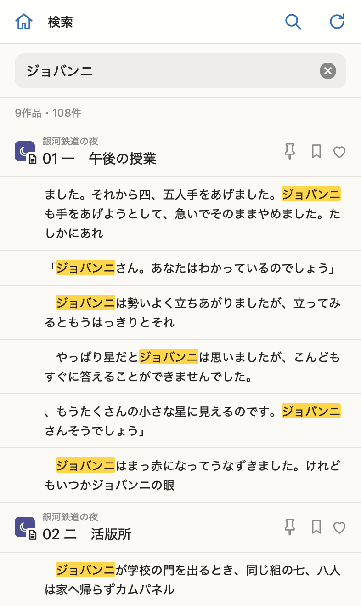

# ユニコブック（unicobook）

ユニコブックは、青空文庫形式の小説を iPhone で縦書きで読むためのビューワ（PWA）です。
Mac が小説フォルダ（iCloud Drive など）を配信し、iPhone は Tailscale を経由してそれを読みます。PC のブラウザでも読めます。

<p>
  
  
  
</p>

> スクリーンショットに写っている作品は、青空文庫で公開されているものです（夏目漱石「坊っちゃん」、宮沢賢治「銀河鉄道の夜」、太宰治「走れメロス」、芥川龍之介「羅生門」「蜘蛛の糸」）。

## 特徴

- **青空文庫形式をそのまま縦書きで表示します**: ルビ・傍点・見出し・字下げ・地付き・縦中横・外字注記・挿絵・改ページに対応しています。文字コードは Shift_JIS と UTF-8 を自動で判定します。
- **フォルダがそのまま本棚になります**: 小説フォルダの直下にあるフォルダがシリーズ、その中のテキストファイルが 1 話ずつの扱いになります。ビルドやデータベースへの登録は要らず、ファイルを置けばすぐに読めます。
- **続きから読めます**: 読書位置はページをめくるたびに保存され、サーバーを通してほかの端末とも共有されます。原稿を書き換えて行がずれても、位置の前後の文字列から探し直します。
- **原稿の変更がわかります**: 前回読んだときから書き換わった段落に色を付け、変更箇所へ順に移動できます。ご自身で書いている小説を、推敲しながら読むのに向いています。
- **オフラインでも読めます**: 一度読んだ話は Service Worker がキャッシュします。

## 導入方法

### おすすめ: AI に任せる

Claude Code などのコーディング AI に、このリポジトリの URL を渡して導入を頼むのがいちばん手軽です。たとえば、次のように伝えてください。

```
https://github.com/whiteleaf7/unicobook を導入してください
```

AI は下の「AI 向けの導入手順」を読んで作業を進めます。途中で、配信したい小説フォルダの場所などを尋ねられるので、答えてください。

### 手作業で導入する

ご自身で導入する場合は、後ろの「[セットアップ](#セットアップ)」の手順に沿って進めてください。

### AI 向けの導入手順

この節は、導入を頼まれた AI エージェントに向けた手順です。上から順に実行してください。

1. **前提を確認する**: macOS であること、`node --version` が 24 以上であること、`pnpm --version` で pnpm が使えることを確かめます。足りなければ、ユーザーにどの方法（nodenv・Homebrew など）で入れるかを確認してから入れてください。依存パッケージはないので、`pnpm install` は不要です。
2. **リポジトリを置く**: `git clone https://github.com/whiteleaf7/unicobook.git` で取得します。置き場所はユーザーに確認してください。launchd にはこの場所のパスを登録するため、導入後にリポジトリを移動するとサーバーが起動しなくなります。
3. **小説フォルダを決める**: 配信する小説フォルダのパスをユーザーに尋ねます（例: iCloud Drive の `~/Library/Mobile Documents/com~apple~CloudDocs/novels`）。フォルダの構成は「[小説フォルダの置き方](#小説フォルダの置き方)」を参照してください。
4. **設定ファイルを作る**: `cp .env.example .env` を実行し、`.env` の `UNICOBOOK_ROOT` を手順 3 のパスに書き換えます。ほかの項目は「[設定](#設定)」の表のとおり既定値のままで構いません。
5. **テストを実行する**: `pnpm test` がすべて通ることを確かめます。
6. **常駐サーバーとして登録する**: `scripts/install-agent.sh` を実行します。ログイン時に自動で起動し、落ちたときは再起動する launchd サービス（`local.unicobook`）として登録されます。
7. **動作を確認する**: `curl -sI http://127.0.0.1:8787/` が `200` を返すことを確かめます。うまくいかないときは `~/Library/Logs/unicobook.log` を読んでください。小説フォルダが iCloud Drive にある場合、初回は macOS が node に iCloud Drive へのアクセス許可を求めるダイアログを出します。ユーザーに「許可」を押してもらってください。許可されないと、ログに `EPERM: operation not permitted` が出てフォルダ一覧が読めません。
8. **iPhone から読めるようにする**: Tailscale が入っていてログイン済みであれば、`tailscale serve --bg 8787` を実行します（`tailscale` コマンドがなければ `/Applications/Tailscale.app/Contents/MacOS/Tailscale` を使います）。tailnet で HTTPS が有効になっていないと、有効にするための URL が表示されるので、ユーザーに開いてもらってください。Tailscale が入っていなければ、この手順は飛ばして、PC のブラウザで `http://localhost:8787/` を開けば読めることを伝えます。
9. **ユーザーに残りの作業を伝える**: `tailscale serve` が表示した `https://<Mac の名前>.<tailnet>.ts.net/` の URL と、「[iPhone](#iphone)」の手順をユーザーに伝えて、導入は完了です。

アイコンやあらすじを Gemini で作る機能は、Antigravity の CLI（`agy`）が必要な任意の機能です。ユーザーから頼まれない限り、設定しなくて構いません。

## スクリーンショット

|                                                    目次                                                     |                                                         表示設定                                                         |                                 ダークテーマ                                 |
| :---------------------------------------------------------------------------------------------------------: | :----------------------------------------------------------------------------------------------------------------------: | :--------------------------------------------------------------------------: |
|  |  |  |

|                                                       検索                                                       |                                                           原稿の変更箇所                                                           |
| :--------------------------------------------------------------------------------------------------------------: | :--------------------------------------------------------------------------------------------------------------------------------: |
|  |  |

PC のブラウザでは、本文を見開きくらいの幅に収めて表示します。


## しくみ

```
iPhone（Safari / ホーム画面の PWA）
   │  HTTPS（Tailscale）
   ▼
tailscale serve ──▶ server/server.ts（127.0.0.1:8787）──▶ 小説フォルダ（UNICOBOOK_ROOT）
```

- `server/server.ts`: 小説フォルダと PWA を配信する Node.js のサーバーです（依存パッケージなし）。`127.0.0.1` だけで待ち受け、外からは `tailscale serve` を経由してアクセスします。ほかのサイトからのリクエストは、Host・Origin・Sec-Fetch-Site を見て拒否します（`guard.ts`）。
  - `config.ts`: 環境変数や `.env` から設定を読みます。
  - `user-store.ts`: 読書位置・印・付箋などのユーザーデータを SQLite に保存します。
  - `icons.ts`: フォルダのアイコンを選んだり、Gemini で作ったりします。
  - `summary.ts`: 設定資料から、Gemini であらすじと登場人物の一覧を作ります。
  - `agy.ts`: Gemini を呼ぶ Antigravity の CLI を動かします。
  - `images.ts`: 大きな画像を縮小して返します。
- `public/`: PWA の本体です（ビルド不要）。
  - `app.js`: ファイラー・メニュー・各シートなど、画面全体を組み立てます。
  - `aozora.js`: 青空文庫記法を解析します。
  - `reader.js`: 縦書きのページを表示し、読書位置を保存・復元します。
  - `store.js`: 設定・読書位置・印などを保存し、サーバーと同期します。
  - `sw.js`: オフライン用のキャッシュです（つながるときは常に最新を取得します）。

小説フォルダに書き込むのは、Gemini で作ったアイコンを置くときだけです。読書位置や設定は `UNICOBOOK_DATA_DIR` に保存します。

### 小説フォルダの置き方

```
小説フォルダ（UNICOBOOK_ROOT）
├── 銀河鉄道の夜/            ← シリーズ（直下のフォルダ）
│   ├── icon.png             ← あればフォルダのアイコンになる
│   ├── 01 一　午後の授業.txt
│   ├── 02 二　活版所.txt
│   └── …
└── 短編集/
    ├── 走れメロス.txt
    └── 羅生門.txt
```

- 1 話を 1 ファイルにする前提です。目次は、同じフォルダにあるテキストファイルをファイル名順に並べたものです（数字は自然な順に並びます）。最後のページには、次の話へのリンクを表示します。
- 挿絵は、テキストファイルからの相対パスで書きます（例: `［＃挿絵（fig1.jpg）入る］` なら、同じフォルダの `fig1.jpg`）。大きな画像は Mac 側で長辺 2000px に縮小して返し、`UNICOBOOK_CACHE_DIR` にキャッシュします。

### フォルダのアイコン

- フォルダに `icon.png`（`icon.jpg` や `icon.webp` なども使えます）を置くと、そのフォルダのアイコンになります。
- アプリでフォルダのアイコンをタップすると、プリセットのアイコン（記号・アルファベット・数字）からも選べます。選んだアイコンは、`UNICOBOOK_DATA_DIR` の `icons.json` に保存します。
- フォルダに置いた画像はプリセットより優先されます。ただし、アイコンを選ぶシートのチェックボックスで、プリセットを優先させることもできます。
- アイコンを選ぶシートの「Gemini で作る」を使うと、フォルダ名（と任意の追加の指示）をもとに Gemini がアイコンを作り、フォルダの `icon.png` として保存します。作業は Mac 側で行い、できあがるまでは「仮」のアイコンを置いておきます。前の画像は、フォルダに `icon~1.png`、`icon~2.png`…と、番号が大きいほど新しくなるように残します。作れなかったときは元に戻します。
- 「続きを読む」や各一覧では、作品が入っているシリーズのアイコンを表示します。

## セットアップ

必要なもの: macOS、Node.js 24 以降、pnpm、Tailscale（iPhone から読む場合）

### Mac

```sh
cp .env.example .env                # 配信するフォルダ（UNICOBOOK_ROOT）などを書き換える
scripts/install-agent.sh            # launchd に登録する（ログイン時に自動で起動する）
tailscale serve --bg 8787           # Tailscale 内に HTTPS で公開する
```

- 配信するフォルダは、`.env` の `UNICOBOOK_ROOT` で指定します。`scripts/install-agent.sh "/path/to/dir"` のように、引数で指定することもできます。
- 小説フォルダが iCloud Drive にある場合、初回に macOS が node に iCloud Drive へのアクセス許可を求めます。許可しないと、フォルダの一覧を読めません。
- nodenv が入っていれば、node はシム経由で起動し、バージョンは nodenv の設定（`.node-version` など）で決まります。node を入れ替えたときは、サーバーを再起動してください（下の「[サーバーの再起動](#サーバーの再起動)」を参照）。
- iCloud の「Mac ストレージを最適化」で本体が削除されているファイルは、開くときにダウンロードを待ちます。小説フォルダを Finder で「ダウンロードを保持」にしておくと速くなります。
- ログは `~/Library/Logs/unicobook.log` に出力されます。登録を解除するときは `scripts/install-agent.sh --uninstall` を実行します。
- `tailscale` コマンドがない場合は、`/Applications/Tailscale.app/Contents/MacOS/Tailscale` を使ってください。

### 設定

設定は、リポジトリ直下の `.env`（git 管理外）に書きます。環境変数で渡した値があれば、そちらが優先されます。パスを `~` で始めると、ホームディレクトリとして扱います。

| 変数                      | 既定値                                    | 内容                                                                                   |
| ------------------------- | ----------------------------------------- | -------------------------------------------------------------------------------------- |
| `UNICOBOOK_ROOT`          | （必須）                                  | 配信する小説フォルダ                                                                   |
| `UNICOBOOK_PORT`          | `8787`                                    | 待ち受けるポート（`127.0.0.1` だけで待ち受けます）                                     |
| `UNICOBOOK_ALLOWED_HOSTS` | なし                                      | `localhost` と `*.ts.net` 以外のホスト名でアクセスする場合に、カンマ区切りで追加します |
| `UNICOBOOK_DATA_DIR`      | `~/Library/Application Support/unicobook` | 読書位置・設定・印・アイコンの選択などの保存先                                         |
| `UNICOBOOK_CACHE_DIR`     | `~/Library/Caches/unicobook`              | 縮小した画像や、アイコンを作るときの作業ファイルの置き場所                             |
| `UNICOBOOK_AGY`           | `~/.local/bin/agy`                        | Gemini でアイコンやあらすじを作るときに使う Antigravity の CLI                         |
| `UNICOBOOK_AGY_MODEL`     | `gemini-3.8-flash-medium`                 | そのときに使うモデル                                                                   |
| `UNICOBOOK_AGY_BRAIN_DIR` | `~/.gemini/antigravity-cli/brain`         | Antigravity の CLI が会話ごとのファイルを置く場所                                      |

Gemini を使う機能（アイコン作りとあらすじ）を使うには、Mac で `agy` にログインしておく必要があります。使わない場合は設定しなくて構いません。なお、アイコンは 1 枚あたり 2〜3 分かかります。

### サーバーの再起動

`server/` や `.env` を変更したときや、nodenv で node を入れ替えたときは、常駐しているサーバーを再起動してください。

```sh
launchctl kickstart -k gui/$(id -u)/local.unicobook
```

- サーバーは、起動したときの node で動き続けます。再起動しないまま古いバージョンの node を削除すると、iCloud Drive を読めなくなります（`EPERM: operation not permitted, scandir ...`）。
- 新しいバージョンの node で初めて起動したときは、macOS が iCloud Drive へのアクセス許可をもう一度求めることがあります。

### iPhone

1. Tailscale アプリをインストールし、Mac と同じアカウントでログインします。
2. Safari で、`tailscale serve` が表示した `https://<Mac の名前>.<tailnet>.ts.net/` を開きます。
3. 共有ボタンから「ホーム画面に追加」を選びます。

### 安全に使うために

ユニコブックは、自分の tailnet の中だけで使う前提で作っています。

- **ログインはありません**: tailnet の中の端末からは、誰でも小説フォルダの全体を読めます。読書位置や印を書き換えたり、Gemini でアイコンを作って小説フォルダに書き込んだりもできます。家族や職場と tailnet を共有している場合は、Tailscale のアクセス制御（ACL）で、Mac の 8787 番ポートにつなげる端末を自分のものだけに絞ってください。
- **`tailscale funnel` は使わないでください**: `funnel` は、インターネット全体に公開する機能です。サーバーは `*.ts.net` のホスト名をすべて受け付けるため、`funnel` で公開すると誰でも読めてしまいます。使うのは `tailscale serve` だけにしてください。
- **小説フォルダには、信頼できるファイルだけを置いてください**: 小説フォルダの中のファイルは、アプリと同じ場所から配信されます。
- **Gemini を使う機能は、内容を Google に送ります**: アイコン作りではフォルダ名と追加の指示を、あらすじ作りでは設定資料の中身を送ります。また、`agy` は確認なしで動くモード（`--dangerously-skip-permissions`）に、サンドボックス（`--sandbox`）を付けて動かします。Gemini を使う機能を使わない場合は、`agy` を設定しなくて構いません。

## 使い方

### ページをめくる

- 画面の左側をタップするか右へスワイプすると次のページへ、右側をタップするか左へスワイプすると前のページへ移ります。スワイプでめくるときは、ページが指に追従します。
- 中央をタップすると、メニュー（フォルダへ戻る・ページ移動・目次・付箋・検索・再読み込み・表示設定）が開きます。メニューの「再読み込み」やファイラーの更新ボタンを長押しすると、ブラウザと同じようにページ自体を再読み込みします。
- 挿絵はダブルタップで全画面表示になり、ピンチで拡大・縮小できます。
- PC のブラウザでは、マウスのクリックやホイール、トラックパッドの横スワイプ、キー操作でページをめくれます。挿絵はホイールで拡大・縮小できます。

| キー                   | 動作                       |
| ---------------------- | -------------------------- |
| ← ↓ PageDown Space     | 次のページ                 |
| → ↑ PageUp Shift+Space | 前のページ                 |
| Home / End             | 最初のページ・最後のページ |
| Esc                    | メニューやシートを閉じる   |

### ファイラー

- トップには、最近開いた 5 件（「もっと表示」で最大 100 件の履歴）と、「後で読む」「お気に入り」の一覧（印を付けた日時が新しい順）、「最近の更新」（フォルダを横断して、更新日時が新しい順に 100 件）への入口を表示します。
- 各行には、既読量・ピン留め・後で読む（栞）・お気に入り（♡）を表示します。ピン留めした項目は、一覧の上に固定されます。並び順は、名前順と更新日時順から選べます。
- フォルダの行には、中の話（サブフォルダも含みます）のうち読み終えた数を「8/12話」のように表示します。
- 最後に読んだあとに更新された話には、各一覧（続きを読む・履歴・印の一覧・最近の更新・検索結果）で既読量の左に小さな点を付けます。フォルダの行も、中の話のどれかが更新されていれば点を付けます（まだ読んでいない話は数えません）。

### 検索

- メニューの「検索」では作品の中を、ファイラーの虫眼鏡では小説フォルダ全体（シリーズのフォルダの中にいるときはそのシリーズ）を検索できます。
- 結果を押すとそのページへ移動し、見つかった言葉に印を付けます。

### 表示設定

- 文字サイズ・行間・上下と左右の余白・フォント（明朝・倫明朝・ゴシック）・テーマ（ライト・ダーク・セピア）を変更できます。
- 倫明朝では、濁点・半濁点付きの仮名（「あ゛」など）を 1 文字にまとめて表示します。

### 原稿の変更と推敲

- 前回読んだときから原稿が変わっていると、変わった段落に色を付け、下のボタンで変更箇所へ順に移動できます。「詳細」では、変更前と変更後を文字単位で見比べられます。印は × で消すまで、何度開いても残ります。
- メニューの「付箋」で、行ごとに推敲メモを残せます。
- シリーズのフォルダに設定資料（ファイル名に「ロードマップ」「キャラ」「設定」「シート」などを含む `.txt` や `.md`）を置くと、ファイラーの本のボタンから、Gemini であらすじと登場人物の一覧を作れます。

### 読書位置の同期

- 読書位置はページをめくるたびに保存され、サーバーを通してほかの端末やブラウザと共有されます。
- 別の端末で先まで読み進めていた場合は、そのページへ移動するかどうかを尋ねます。
- アプリに戻ったとき、開いているファイルが更新されていれば、自動で読み直します。

## 開発

動かすだけなら依存パッケージは要りませんが、整形（Biome）とリント（oxlint）を使うときは、先に `pnpm install` を実行してください。

```sh
pnpm install  # 整形とリントの道具を入れる（開発するときだけ）
pnpm start    # サーバーを起動する（設定は .env）
pnpm test     # テストを実行する
pnpm format   # 整形する
pnpm lint     # リントと型チェックをする
swift scripts/make-icons.swift public/icons /path/to/icon.png   # アプリのアイコンを作り直す
swift scripts/make-placeholder-icon.swift server/placeholder-icon.png   # 「仮」のアイコンを作り直す
```

favicon（`public/icons/favicon-32.png` と `favicon-64.png`）は、タブで小さく見えないよう、元画像を黒いシルエットの外接矩形に 6% の余白を加えた正方形で切り抜き、縮小したものです。

## ライセンス

MIT License です（`LICENSE` を参照してください）。

ただし、同梱しているフォント「倫明朝」（`public/fonts/`）は、SIL Open Font License 1.1 で配布されています。詳しくは `public/fonts/OFL.txt` と `public/fonts/readme.txt` を参照してください。
