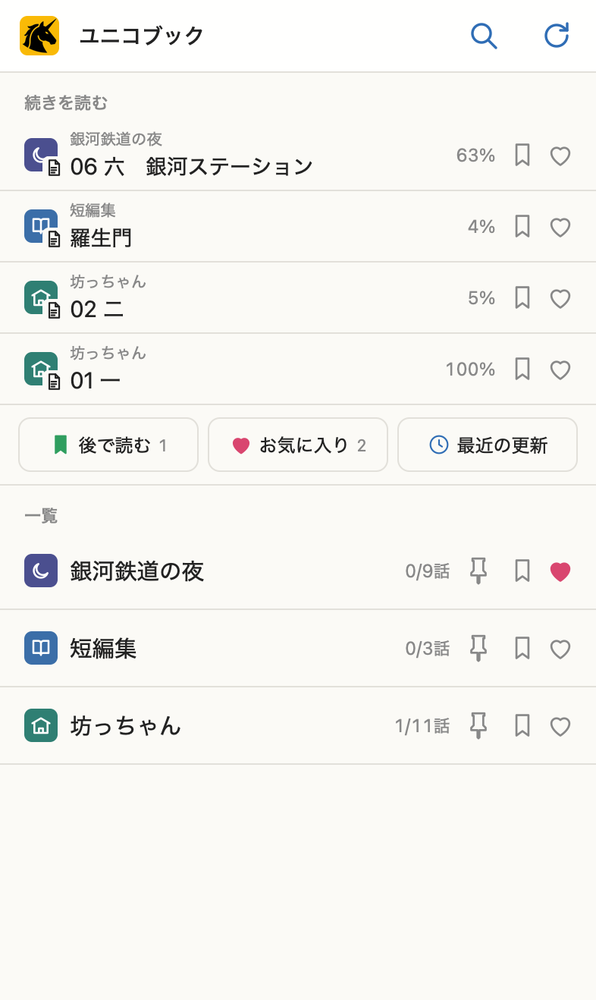
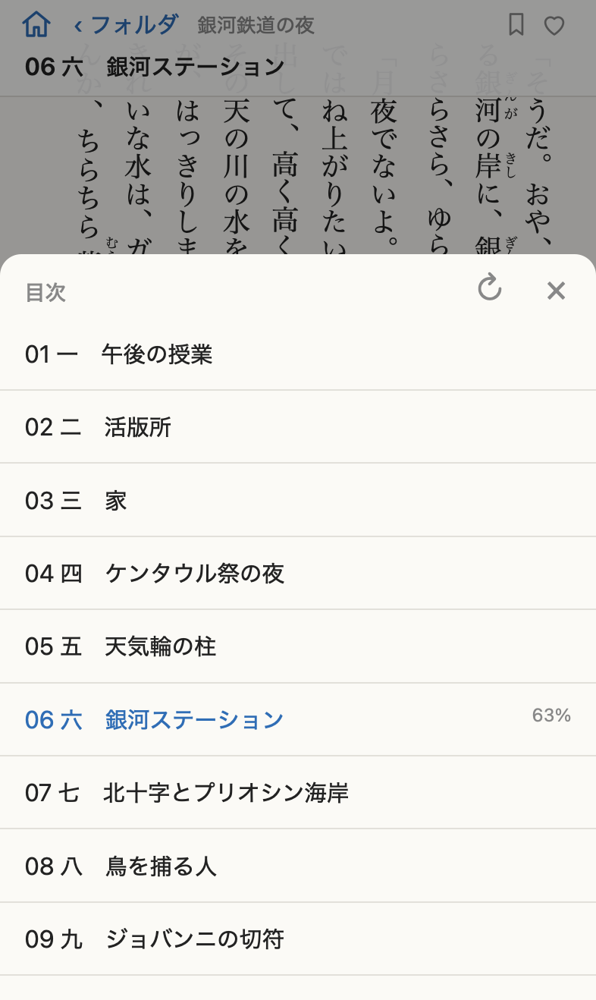
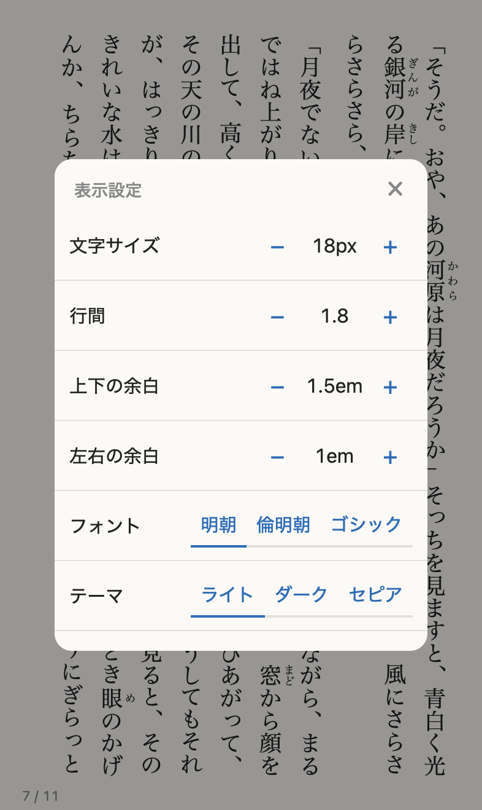

# novelbook（ユニコブック）

iPhone で読む、青空文庫形式の縦書き小説ビューワ（PWA）。
Mac が小説フォルダ（iCloud Drive など）を配信し、iPhone は Tailscale 経由でそれを読む。PC のブラウザでも読める。

<p>
  
  
  
</p>

> スクリーンショットの作品は青空文庫の公開作品（夏目漱石「坊っちゃん」、宮沢賢治「銀河鉄道の夜」、太宰治「走れメロス」、芥川龍之介「羅生門」「蜘蛛の糸」）。

## 特徴

- **青空文庫形式をそのまま縦書きで**: ルビ・傍点・見出し・字下げ・地付き・縦中横・外字注記・挿絵・改ページに対応。Shift_JIS と UTF-8 を自動で判定する
- **フォルダがそのまま本棚に**: 小説フォルダの直下のフォルダがシリーズ、その中のテキストファイルが 1 話ずつの扱いになる。ビルドもデータベースへの登録も要らず、ファイルを置けばすぐ読める
- **読書の続きから**: 読書位置はページをめくるたびに保存し、サーバー経由でほかの端末とも共有する。原稿を書き換えて行がずれても、位置の前後の文字列で探し直す
- **原稿の変更がわかる**: 前回読んだときから書き換わった段落に色を付け、変更箇所へ順に移れる。自分で書いている小説を推敲しながら読むのに向く
- **オフラインでも読める**: Service Worker が読んだ話をキャッシュする
- **依存なし**: サーバーは Node.js の標準モジュールだけ、PWA はビルドなしの素の JavaScript

## スクリーンショット

| 目次 | 表示設定 | ダークテーマ |
| :---: | :---: | :---: |
|  |  |  |

| 検索 | 原稿の変更箇所 |
| :---: | :---: |
|  |  |

PC のブラウザでは、本文を見開きくらいの幅に収める。


## しくみ

```
iPhone（Safari / ホーム画面の PWA）
   │  HTTPS（Tailscale）
   ▼
tailscale serve ──▶ server/server.ts（127.0.0.1:8787）──▶ 小説フォルダ（NOVELBOOK_ROOT）
```

- `server/server.ts`: 小説フォルダと PWA を配信する Node のサーバー（依存なし）。`127.0.0.1` だけで待ち受け、外からは `tailscale serve` 経由でアクセスする。ほかのサイトからのリクエストは Host・Origin・Sec-Fetch-Site を見て断る
- `public/`: PWA 本体（ビルドなし）
  - `aozora.js`: 青空文庫記法の解析
  - `reader.js`: 縦書きのページ表示と読書位置の保存・復元
  - `store.js`: 設定・読書位置・印などの保存と、サーバーとの同期
  - `sw.js`: オフライン用のキャッシュ（つながるときは常に最新を取る）

小説フォルダに書き込むのは、Gemini で作ったアイコンを置くときだけ。読書位置や設定は `NOVELBOOK_DATA_DIR` に保存する。

### 小説フォルダの置き方

```
小説フォルダ（NOVELBOOK_ROOT）
├── 銀河鉄道の夜/            ← シリーズ（直下のフォルダ）
│   ├── icon.png             ← あればフォルダのアイコンになる
│   ├── 01 一　午後の授業.txt
│   ├── 02 二　活版所.txt
│   └── …
└── 短編集/
    ├── 走れメロス.txt
    └── 羅生門.txt
```

- 1 話 1 ファイルの前提で、目次は同じフォルダのテキストファイルをファイル名順に並べたもの（数字は自然な順に並ぶ）。最後のページには次の話へのリンクを出す
- 挿絵は、テキストファイルからの相対パスで書く（例: `［＃挿絵（fig1.jpg）入る］` なら同じフォルダの `fig1.jpg`）。大きな画像は Mac 側で長辺 2000px に縮小して返し、`NOVELBOOK_CACHE_DIR` にキャッシュする

### フォルダのアイコン

- フォルダに `icon.png`（`icon.jpg` / `icon.webp` なども可）を置くと、そのフォルダのアイコンになる
- アプリでフォルダのアイコンをタップすると、プリセットのアイコン（記号・アルファベット・数字）からも選べる。選択は `NOVELBOOK_DATA_DIR` の `icons.json` に保存する
- フォルダに置いた画像はプリセットより優先されるが、アイコンを選ぶシートのチェックボックスでプリセットを優先させることもできる
- アイコンを選ぶシートの「Gemini で作る」では、フォルダ名（と任意の追加の指示）から Gemini にアイコンを作ってもらい、フォルダの `icon.png` にする。Mac 側で作り、できあがるまでは「仮」のアイコンを置いておく。前の画像はフォルダに `icon~1.png`、`icon~2.png`…と番号が大きいほど新しくなるように残し、作れなかったときは元に戻す
- 続きを読むや各一覧では、作品の入っているシリーズのアイコンを出す

## セットアップ

必要なもの: macOS、Node.js 24 以降、Tailscale（iPhone から読むとき）

### Mac

```sh
cp .env.example .env                # 配信するフォルダ（NOVELBOOK_ROOT）などを書き換える
scripts/install-agent.sh            # launchd に登録（ログイン時に自動起動）
tailscale serve --bg 8787           # Tailscale 内に HTTPS で公開
```

- 配信するフォルダは `.env` の `NOVELBOOK_ROOT`。`scripts/install-agent.sh "/path/to/dir"` のように引数でも指定できる
- 小説フォルダが iCloud Drive にあるときは、初回に macOS が node の iCloud Drive へのアクセス許可を求める。許可しないとフォルダ一覧が読めない
- nodenv があれば node はシム経由で起動し、バージョンは `.node-version` で決まる。node を入れ替えたら再起動する（下の「サーバーの再起動」）
- iCloud の「Mac ストレージを最適化」で本体が消えているファイルは、開くときにダウンロードを待つ。小説フォルダは Finder で「ダウンロードを保持」にしておくと速い
- ログ: `~/Library/Logs/novelbook.log`。解除: `scripts/install-agent.sh --uninstall`
- `tailscale` コマンドがなければ `/Applications/Tailscale.app/Contents/MacOS/Tailscale` を使う

### 設定

設定はリポジトリ直下の `.env`（git 管理外）に書く。環境変数で渡せばそちらが優先される。パスは `~` で始めるとホームディレクトリとして扱う。

| 変数 | 既定値 | 内容 |
| --- | --- | --- |
| `NOVELBOOK_ROOT` | （必須） | 配信する小説フォルダ |
| `NOVELBOOK_PORT` | `8787` | 待ち受けるポート（`127.0.0.1` だけで待ち受ける） |
| `NOVELBOOK_ALLOWED_HOSTS` | なし | `localhost` と `*.ts.net` 以外のホスト名でアクセスするときに、カンマ区切りで追加する |
| `NOVELBOOK_DATA_DIR` | `~/Library/Application Support/novelbook` | 読書位置・設定・印・アイコンの選択などの保存先 |
| `NOVELBOOK_CACHE_DIR` | `~/Library/Caches/novelbook` | 縮小した画像や、アイコンを作るときの作業ファイルの置き場所 |
| `NOVELBOOK_AGY` | `~/.local/bin/agy` | Gemini でアイコンやあらすじを作るときに使う Antigravity の CLI |
| `NOVELBOOK_AGY_MODEL` | `gemini-3.8-flash-medium` | そのとき使うモデル |
| `NOVELBOOK_AGY_BRAIN_DIR` | `~/.gemini/antigravity-cli/brain` | Antigravity の CLI が会話ごとのファイルを置く場所 |

Gemini を使う機能（アイコン作り・あらすじ）は、Mac で `agy` にログインしておく必要がある。使わないなら設定しなくてよい。アイコンは 1 枚に 2〜3 分かかる。

### サーバーの再起動

`server/` や `.env` を変えたときや、nodenv で node を入れ替えたときは、常駐しているサーバーを再起動する。

```sh
launchctl kickstart -k gui/$(id -u)/local.novelbook
```

- サーバーは起動したときの node で動き続ける。再起動しないまま古い版の node を消すと、iCloud Drive が読めなくなる（`EPERM: operation not permitted, scandir ...`）
- 新しい版の node で初めて起動すると、macOS が iCloud Drive へのアクセス許可をもう一度求めることがある

### iPhone

1. Tailscale アプリを入れて、Mac と同じアカウントでログインする
2. Safari で `tailscale serve` が表示した `https://<Mac の名前>.<tailnet>.ts.net/` を開く
3. 共有 → 「ホーム画面に追加」

## 使い方

### ページをめくる

- 画面の左側をタップ／右へスワイプで次のページ、右側をタップ／左へスワイプで前のページ。スワイプでめくるとページが指に追従する
- 中央をタップでメニュー（フォルダへ戻る・ページ移動・目次・付箋・検索・再読み込み・表示設定）。メニューの「再読み込み」やファイラーの更新ボタンは、長押しでページ自体をブラウザ的に再読み込み
- 挿絵はダブルタップで全画面表示になり、ピンチで拡大縮小できる
- PC のブラウザでは、マウスのクリック・ホイール・トラックパッドの横スワイプや、キーでめくれる。挿絵はホイールで拡大縮小できる

| キー | 動き |
| --- | --- |
| ← ↓ PageDown Space | 次のページ |
| → ↑ PageUp Shift+Space | 前のページ |
| Home / End | 最初と最後のページ |
| Esc | メニューやシートを閉じる |

### ファイラー

- トップには最近開いた 5 件（「もっと表示」で最大 100 件の履歴）と、後で読む・お気に入りの一覧（印を付けた日時が新しい順）、最近の更新（フォルダを横断して更新日時が新しい順に 100 件）への入口を出す
- 各行には既読量・ピン留め・後で読む（栞）・お気に入り（♡）を表示する。ピン留めした項目は一覧の上に固定される。並び順は名前順・更新日時順から選べる
- フォルダの行には、中の話（サブフォルダも含む）のうち読み終えた数を「8/12話」のように出す
- 最後に読んだあとに更新された話は、各一覧（続きを読む・履歴・印の一覧・最近の更新・検索結果も）で既読量の左に小さな点を付ける。フォルダの行も、中の話のどれかがそうなら点を付ける（まだ読んでいない話は数えない）

### 検索

- メニューの「検索」で作品の中を、ファイラーの虫眼鏡で小説フォルダ全体（シリーズのフォルダの中ではそのシリーズ）を検索できる
- 結果を押すとそのページへ移り、見つかった言葉に印を付ける

### 表示設定

- 文字サイズ・行間・上下と左右の余白・フォント（明朝・倫明朝・ゴシック）・テーマ（ライト・ダーク・セピア）を変えられる
- 倫明朝では、濁点・半濁点付きの仮名（「あ゛」など）を 1 字にまとめて表示する

### 原稿の変更と推敲

- 前回読んだときから原稿が変わっていたら、変わった段落に色を付け、下のボタンで変更箇所へ順に移れる。「詳細」で変更前と変更後を文字単位で見比べられる。印は × で消すまで、何度開いても残る
- メニューの「付箋」で、行ごとに推敲メモを残せる
- シリーズのフォルダに設定資料（ファイル名に「ロードマップ」「キャラ」「設定」「シート」などを含む `.txt` / `.md`）を置くと、ファイラーの本のボタンから Gemini であらすじと登場人物の一覧を作れる

### 読書位置の同期

- 読書位置はページをめくるたびに保存され、サーバーを通してほかの端末やブラウザと共有する
- 別の端末で先まで読み進めていたら、そのページへ移るか尋ねる
- アプリに戻ったとき、開いているファイルが更新されていれば自動で読み直す

## 開発

```sh
npm start   # サーバーを起動（設定は .env）
npm test    # テスト
swift scripts/make-icons.swift public/icons /path/to/icon.png   # アイコンの再生成
swift scripts/make-placeholder-icon.swift server/placeholder-icon.png   # 「仮」のアイコンの再生成
```

favicon（`public/icons/favicon-32.png` / `favicon-64.png`）は元画像を、タブで小さく見えないよう黒いシルエットの外接矩形＋6% の余白で正方形に切り抜いて縮小したもの。

## ライセンス

MIT License（`LICENSE` を参照）。

ただし、同梱のフォント「倫明朝」（`public/fonts/`）は SIL Open Font License 1.1 で配布されている。詳しくは `public/fonts/OFL.txt` と `public/fonts/readme.txt` を参照。
